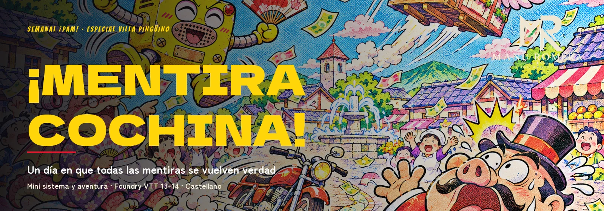
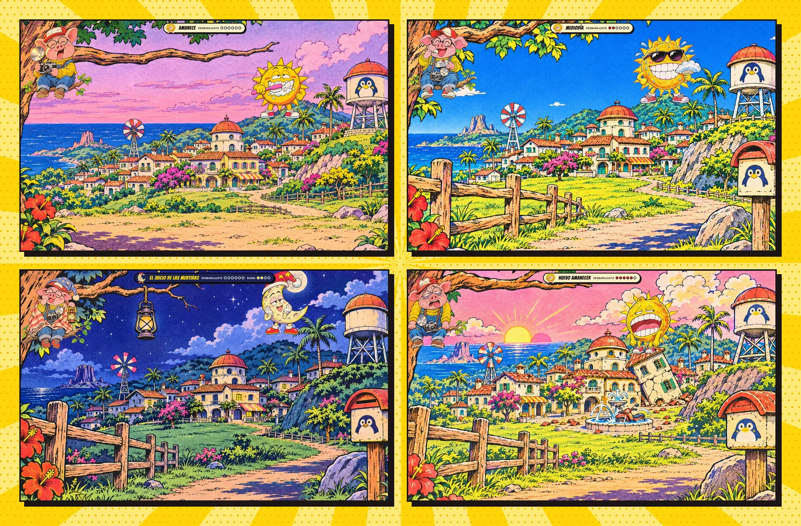
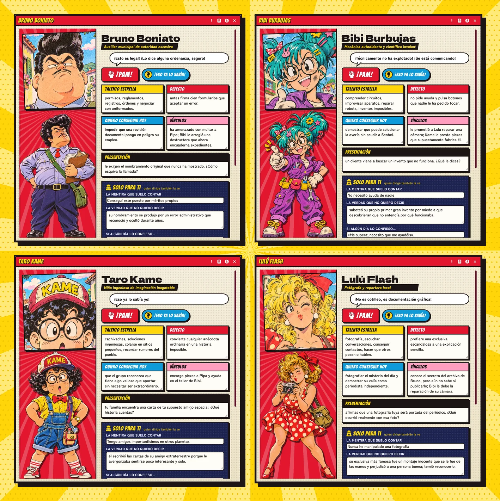
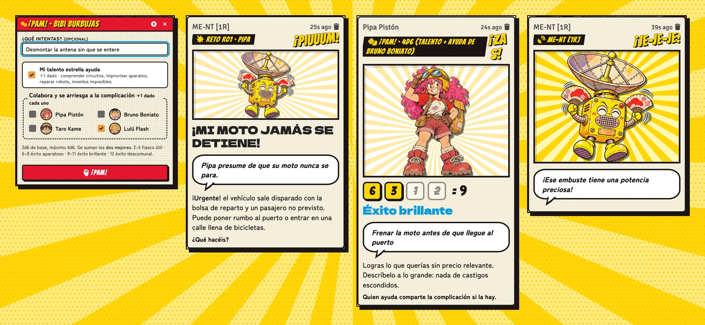
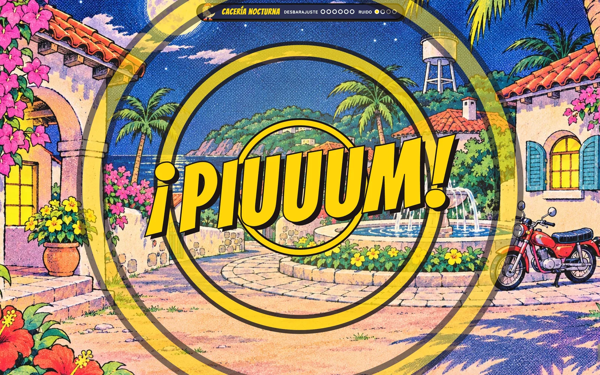
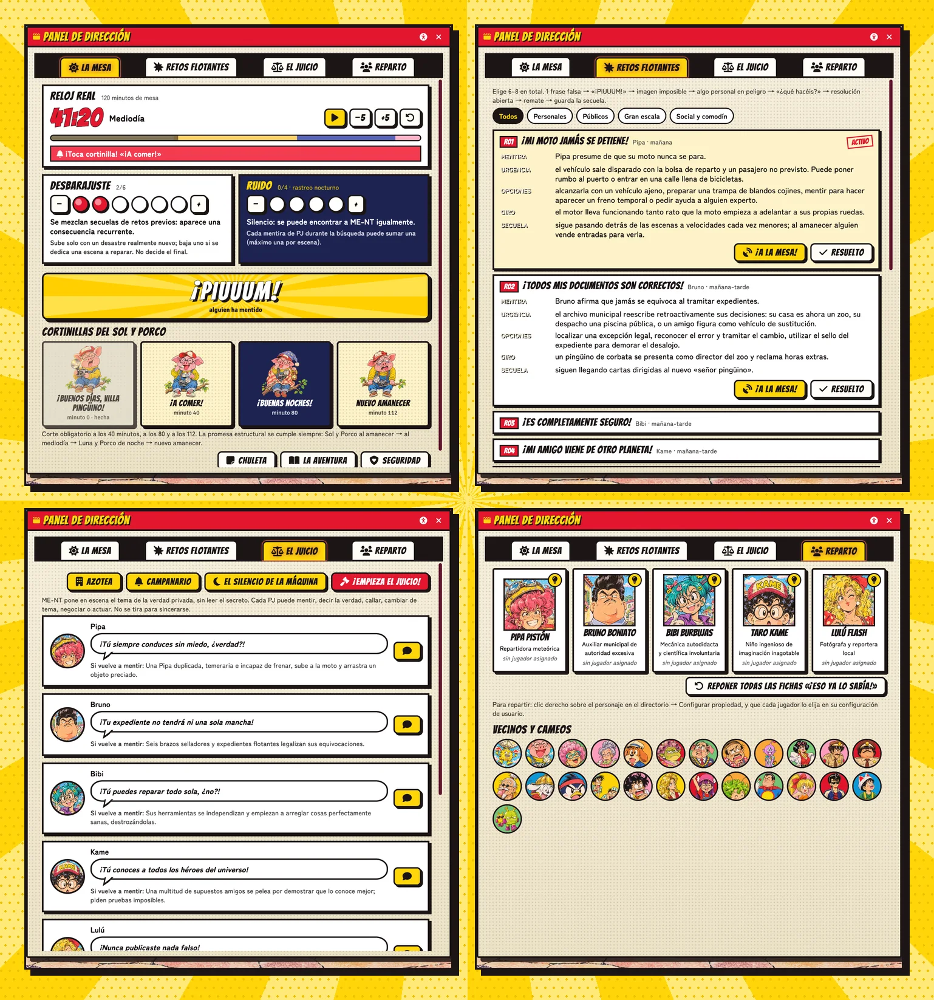
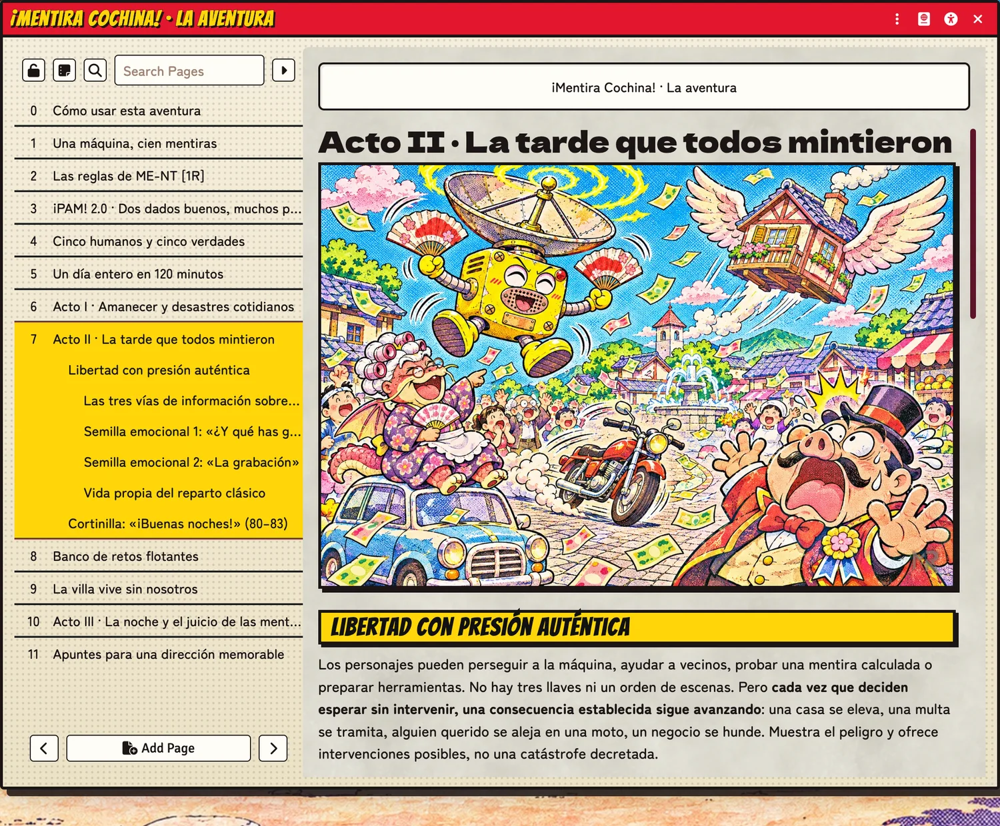
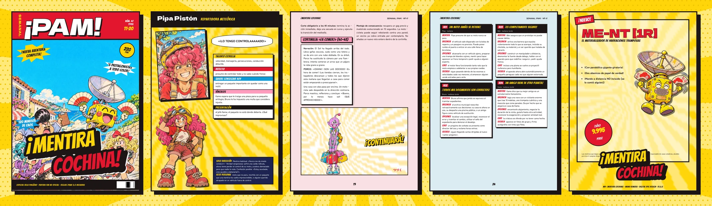

<p align="center">
  
</p>

<p align="center">
  <a href="https://github.com/ManuRomera"></a>
  <a href="https://github.com/ManuRomera/mr-mentira-cochina/releases/latest"></a>
  <a href="https://github.com/ManuRomera/mr-mentira-cochina/releases"></a>
  
  
  
</p>

# MR- ¡Mentira Cochina!

Mini sistema y aventura de inicio para **Foundry VTT**: una comedia de enredo de 120 minutos en Villa Pingüino. Durante un solo día, una caja amarilla con una parabólica ridícula, **ME-NT [1R]**, vuelve ciertas las mentiras de todo el pueblo. Al caer la noche, los protagonistas la persiguen sin sospechar que no necesita que la derroten, sino escuchar una verdad dicha sin esperar nada a cambio.

Es una partida **cachonda y desenfadada**, para tres a cinco jugadores y quien dirige, y un sistema ligero que no pretende más que ponerlo fácil para reírse. Todo —sistema, aventura y PDF— tiene el aspecto de una **revista semanal de manga shōnen de 1995**: papel de periódico, tramas de puntos, viñetas con sombra dura, globos y onomatopeyas.

<p align="center"></p>

## Cinco personajes, cinco verdades

Cada jugador recibe un perfil de revista con retrato, figura, talento, defecto, vínculos y una **ficha privada** («Solo para ti») que solo ven él y quien dirige. Desde la ficha se lanza el **¡PAM!** y se gasta la ficha «¡Eso ya lo sabía!».

<p align="center"></p>

## Una tirada, mucho ruido

**¡PAM! 2.0:** 2d6, +1d6 por el talento estrella y +1d6 por cada personaje que ayuda (máximo 4d6). Se suman los **dos mejores**: 2–5 fiasco útil, 6–8 éxito aparatoso, 9–11 éxito brillante, 12 éxito descomunal. La tarjeta marca los dados que cuentan y suelta su onomatopeya; con Dice So Nice, espera a que paren los dados.

<p align="center"></p>

Cada vez que alguien miente y ME-NT lo materializa, quien dirige pulsa **¡PIUUUM!** y toda la mesa ve y oye el destello.

<p align="center"></p>

## El gestor de la partida

El **Panel de dirección** lleva el reloj real de 120 minutos (y avisa cuando toca cortinilla), los marcadores de **Desbarajuste** (0–6) y **Ruido** (0–4), las cuatro cortinillas del Sol, la Luna y Porco, los **18 retos flotantes**, el juicio de las mentiras con las provocaciones de ME-NT, los cuatro finales y el reparto. Una **cartela** flotante enseña a toda la mesa la hora del día y los marcadores.

<p align="center"></p>

## La aventura, completa en Foundry

Se instala sola en un mundo vacío: 16 decorados, 5 personajes jugadores, 16 vecinos, 9 cameos del reparto clásico y el diario de dirección con todas sus láminas.

<p align="center"></p>

## El PDF: un número de la revista

El libro de la aventura va maquetado como un número de la revista «¡PAM!» (B5, 44 páginas): portada, índice, láminas a color al empezar cada acto, fichas de personaje, los retos en tarjetas, fichas privadas para recortar, encuesta del lector y un anuncio de ME-NT en la contraportada. Está en cada [versión publicada](https://github.com/ManuRomera/mr-mentira-cochina/releases/latest).

<p align="center"></p>

## Lo de siempre

Accesibilidad (tamaño de texto, alto contraste, fuente legible, sin movimiento, modo oscuro), seguridad en mesa (Pausa, Velo y Tarjeta X anónimas), memoria de ventanas, lupa sobre las imágenes, diagnóstico y créditos en Ajustes.

## Instalación

En Foundry: **Sistemas de juego → Instalar sistema** y pega el manifiesto:

```
https://github.com/ManuRomera/mr-mentira-cochina/releases/latest/download/system.json
```

Crea un mundo con este sistema y entra como GM: la aventura se importa sola. El PDF de la aventura está en cada [versión publicada](https://github.com/ManuRomera/mr-mentira-cochina/releases/latest).

## Créditos

Aventura, sistema y dirección artística: Manu Romera. Arte generado para esta partida a partir de diseños propios y de cosplays. Tipografías Bangers, Dela Gothic One y Zen Maru Gothic (SIL OFL 1.1). Partida fan, original y no oficial, ambientada en el universo de una serie de Akira Toriyama; sin ánimo de lucro.
